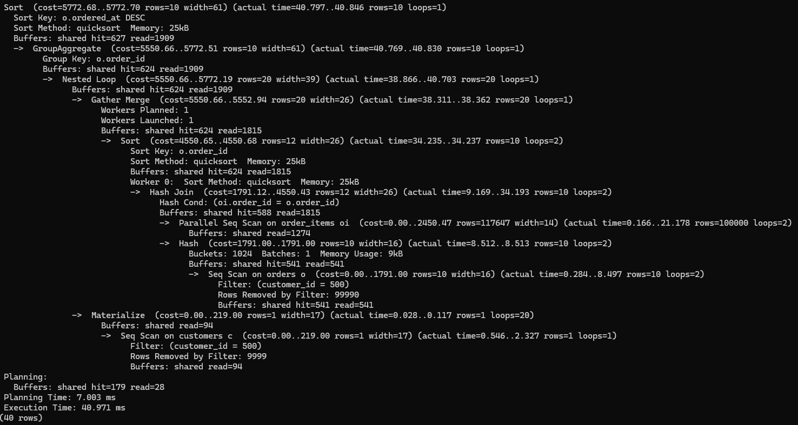
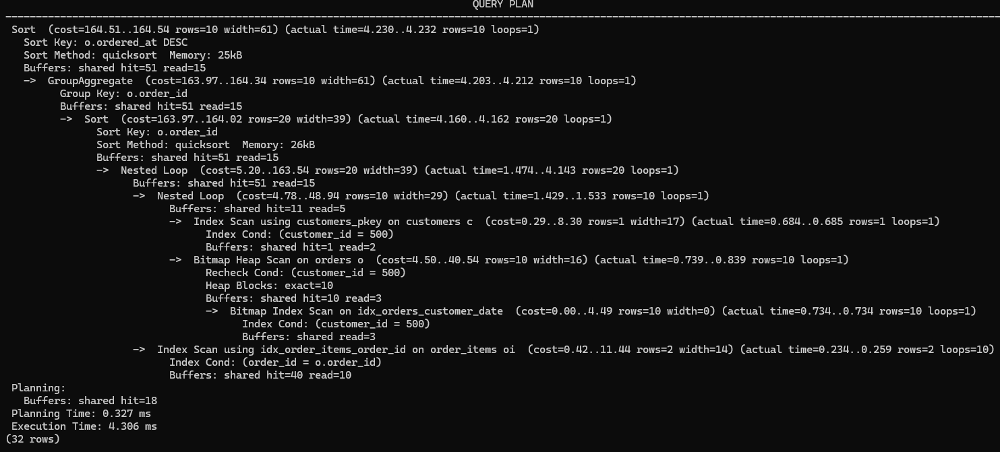
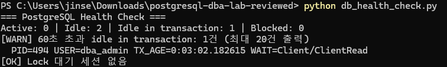

# PostgreSQL DBA Lab

PostgreSQL 16, Docker, pgAdmin 및 Python을 활용하여 데이터 무결성, 트랜잭션, 실행계획 분석, 인덱스 설계 및 세션 상태 점검을 실습한 개인 프로젝트입니다. 로컬 테스트 환경에서 수행한 과정을 SQL·Python 코드와 측정 기록으로 정리했습니다.

## 프로젝트 핵심 사례

1. **데이터 무결성:** 고객·상품·주문·주문상세·재고의 관계와 PK/FK/CHECK 제약조건을 구성했습니다.
2. **트랜잭션 검증:** 재고 차감 후 ROLLBACK, 주문상세 CHECK 위반 후 ROLLBACK을 통해 데이터 복구 여부를 확인할 수 있도록 구성했습니다.
3. **JOIN 성능 분석:** 합성 데이터 311,000건에 대해 실행계획을 확인하고 조회 조건을 근거로 인덱스를 설계했습니다.
4. **세션 점검:** Python과 `pg_stat_activity`를 사용해 장기 미종료 트랜잭션과 잠금 대기를 조회합니다.

## 파일 구성

| 경로 | 내용 |
|---|---|
| `sql/01_schema.sql` | 이커머스 테이블 5개 및 제약조건 |
| `sql/02_seed_data.sql` | 고객·상품·재고 및 샘플 주문 1건 등록 |
| `sql/03_transaction_test.sql` | 재고 차감 후 ROLLBACK |
| `sql/03b_failed_order_test.sql` | CHECK 오류와 트랜잭션 취소 재현 |
| `sql/04_benchmark_schema.sql` | 별도 벤치마크 스키마와 테이블 |
| `sql/05_benchmark_data.sql` | 합성 데이터 311,000건 생성 및 정합성 검사 |
| `sql/08_benchmark_query.sql` | JOIN 실행계획·버퍼·실행 시간 측정 |
| `sql/06_index_optimization.sql` | 고객/주문 JOIN을 위한 인덱스 생성 |
| `sql/07_health_queries.sql` | 세션, 트랜잭션, 잠금 대기 조회 |
| `sql/09_validation.sql` | 데이터 건수와 주문 관계 검증 |
| `db_health_check.py` | Python 기반 로컬 DB 상태 점검 |
| `docs/performance_results.md` | 실제 측정값, 비교 조건 및 한계 |

## 실행 환경

- PostgreSQL 16 / Docker / pgAdmin
- Python 3 / psycopg 3
- 데이터베이스: `dba_lab`
- 스키마: `ecommerce`, `ecommerce_bench`
- 접속 예시: `127.0.0.1:5433` (`dba-postgres` Docker 컨테이너)

## 새 실습 DB에서 실행하는 순서

1. `01_schema.sql` → `02_seed_data.sql` → `03_transaction_test.sql`
2. `03b_failed_order_test.sql`은 **전체 선택 실행하지 않고**, 파일 내 ① 시작·UPDATE, ② 오류 INSERT, ③ ROLLBACK을 각각 실행합니다. 정상적인 예상 오류는 SQLSTATE `23514`이며, 오류가 발생한 뒤에는 반드시 `ROLLBACK;`을 별도로 실행합니다.
3. `04_benchmark_schema.sql` → `05_benchmark_data.sql`
4. `08_benchmark_query.sql`로 **인덱스 적용 전** 실행계획 확인
5. `06_index_optimization.sql`로 인덱스 생성
6. `08_benchmark_query.sql`로 **인덱스 적용 후** 실행계획 확인
7. `09_validation.sql`로 전체 데이터 건수를 확인합니다. `07_health_queries.sql` 및 `db_health_check.py`는 필요에 따라 실행합니다.

**중요:** 기존 `dba_lab`에 데이터가 있다면 `01`~`05` 파일을 처음부터 다시 실행할 필요가 없습니다. 특히 `05_benchmark_data.sql`은 테이블에 데이터가 이미 있으면 예외를 발생시키고 중단합니다. 기존 환경을 보존하려면 별도의 빈 데이터베이스에서 재현하는 것을 권장합니다. `CREATE TABLE IF NOT EXISTS`는 기존 테이블 정의가 파일과 일치하는지 확인하지 않습니다.

`02_seed_data.sql`의 샘플 주문은 주문 데이터의 JOIN 재현을 위한 초기 상태이며, 재고 차감·결제 완료를 의미하지 않습니다. 기존 동일 구성 주문이 있으면 중복 삽입하지 않도록 처리했습니다.

## Python 모니터링 실행 (Windows PowerShell 5.1)

```powershell
python -m pip install -r requirements.txt

$secure = Read-Host "PostgreSQL 비밀번호" -AsSecureString
$env:DB_PASSWORD = [System.Net.NetworkCredential]::new("", $secure).Password

python db_health_check.py
python db_health_check.py --idle-seconds 30
```

접속값은 `DB_HOST`, `DB_PORT`, `DB_NAME`, `DB_USER` 환경변수로 변경할 수 있습니다. 비밀번호는 `DB_PASSWORD`로 전달하며 저장소에 포함하지 않습니다. 프로그램은 로컬 상태 점검용으로 구성했으며 자동 알림·장애 복구 기능은 포함하지 않습니다.


### 인덱스 스캔 제한 실행계획


### 인덱스 사용 실행계획


### Python DB 모니터링


## 성능 측정 결과

| 측정 조건 | 실행 시간 |
|---|---:|
| 신규 인덱스 적용 전 단회 | 17.621 ms |
| 신규 인덱스 적용 직후 단회 | 1.111 ms |
| 인덱스 사용 5회 평균(2차) | 0.1818 ms |
| 인덱스 스캔 제한 5회 평균(최종) | 18.9172 ms |

인덱스 적용 후 `orders`는 Bitmap Index Scan·Bitmap Heap Scan을, `order_items`는 Index Scan을 사용했습니다. 상세 실행계획과 반복 측정 원자료는 [`docs/performance_results.md`](docs/performance_results.md)에 정리했습니다.

## 범위 및 한계

- 개인 로컬 실습 결과이며 운영 서비스 환경의 성능 수치가 아닙니다.
- 합성 데이터는 단순한 균등 분포를 사용하며 실제 쇼핑몰의 주문 패턴과 다릅니다.
- 최초 측정 자료와 제공된 재현 코드 간 환경·캐시·실행 시점 차이로 측정값이 달라질 수 있습니다.
- 인덱스 스캔 제한 실험은 PK를 포함한 다른 인덱스에도 영향을 주므로, 새로 추가한 두 인덱스의 독립적인 효과를 나타내지 않습니다.
- 실습 과정에서 진행한 사용자 권한 설정, 백업·복원, Deadlock 테스트는 **현재 저장소의 재현 코드 범위에 포함하지 않았습니다.** 별도 검증 자료가 정리되면 추가할 예정입니다.
