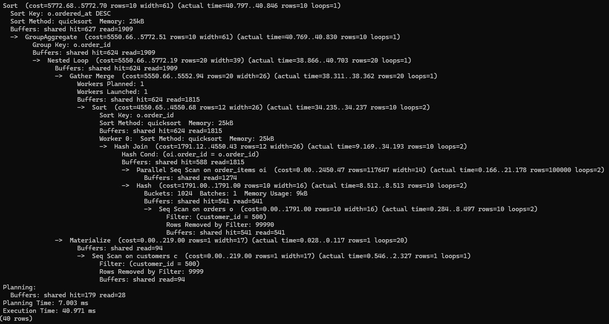
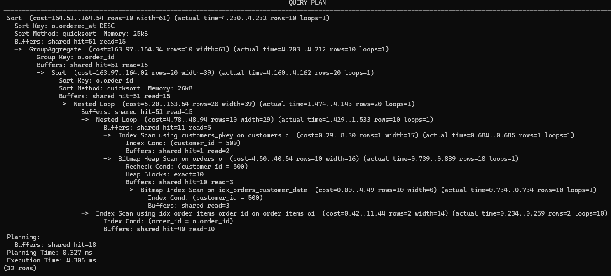

# 03. JOIN 및 인덱스 성능 비교

## 목적
특정 고객의 주문 금액을 조회할 때 인덱스 적용 전후의 실행 계획과 시간을 비교했습니다.

## 진행 방식
`ecommerce_bench` 스키마에 가상 데이터를 생성했습니다.

| 테이블 | 건수 |
|---|---:|
| 고객 | 10,000 |
| 상품 | 1,000 |
| 주문 | 100,000 |
| 주문상세 | 200,000 |
| **합계** | **311,000** |

고객 500번의 주문 10건과 관련 주문상세 20건을 조회했습니다.

처음 실행 계획에는 `Seq Scan`과 `Parallel Seq Scan`이 나타났습니다. 이후 조회 조건과 JOIN에 사용하는 컬럼을 기준으로 인덱스 두 개를 만들었습니다.

```sql
CREATE INDEX idx_orders_customer_date
ON ecommerce_bench.orders (customer_id, ordered_at DESC);

CREATE INDEX idx_order_items_order_id
ON ecommerce_bench.order_items (order_id);
```

### 인덱스 스캔 제한 시 실행 계획


### 인덱스 사용 시 실행 계획


## 측정 결과

| 측정 조건 | 실행 시간 |
|---|---:|
| 인덱스 적용 전 1회 | 17.621ms |
| 인덱스 적용 직후 1회 | 1.111ms |
| 인덱스 사용 5회 평균(2차) | 0.1818ms |
| 인덱스 스캔 제한 5회 평균(최종) | 18.9172ms |

인덱스 적용 전후 **1회 측정값은 약 93.7% 감소**했습니다. 다만 캐시와 실행 환경의 영향을 받을 수 있어 일반적인 개선율로 판단하지 않았습니다.

또한 인덱스 스캔을 제한한 실험은 **기존 PK 인덱스 사용에도 영향**을 줍니다. 따라서 새 인덱스 두 개만의 효과를 따로 측정한 결과와는 구분했습니다.

## 배운 점
인덱스를 추가하기 전에 **어느 테이블을 어떻게 조회하는지** 실행 계획을 확인해야 한다는 점을 배웠습니다. 실제 실행 시간과 버퍼 사용량도 함께 비교했습니다.

**상세 측정값:** [성능 측정 원자료](performance_results.md)

**SQL:** [데이터 생성](../sql/05_benchmark_data.sql) · [인덱스 생성](../sql/06_index_optimization.sql) · [조회 및 측정](../sql/08_benchmark_query.sql)
