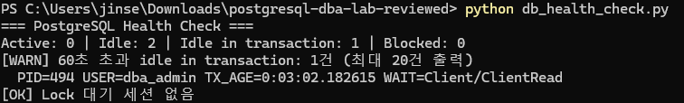

# 04. PostgreSQL 상태 점검

## 목적
Python으로 DB 연결 상태와 오래 종료되지 않은 트랜잭션을 확인했습니다.

## 진행 방식
`pg_stat_activity`와 `pg_blocking_pids()`를 이용해 다음 항목을 조회했습니다.

- 실행 중인 세션 수
- 대기 중인 세션 수
- 종료되지 않은 트랜잭션 수
- 60초를 넘긴 트랜잭션
- 다른 세션 때문에 잠금 대기 중인 작업

테스트를 위해 트랜잭션을 시작한 뒤 바로 종료하지 않고 유지한 상태에서 Python 점검 프로그램을 실행했습니다.

### 실행 결과

## 결과 및 배운 점
약 **3분 동안 유지된 `idle in transaction` 세션 1건**을 발견했습니다. 프로그램에는 세션 PID와 경과 시간이 출력됐습니다. 당시 잠금 대기 세션은 없었습니다.

테스트 후 `ROLLBACK`으로 트랜잭션을 종료했습니다.

문제가 발생한 뒤 확인하는 것뿐 아니라, 종료되지 않은 작업을 찾아보는 점검도 중요하다는 점을 배웠습니다.

현재 코드는 **실행 시점에 상태를 확인하는 도구**이며 자동 알림이나 장애 복구 기능은 없습니다.

**Python:** [db_health_check.py](../db_health_check.py) · **SQL:** [상태 조회](../sql/07_health_queries.sql)
